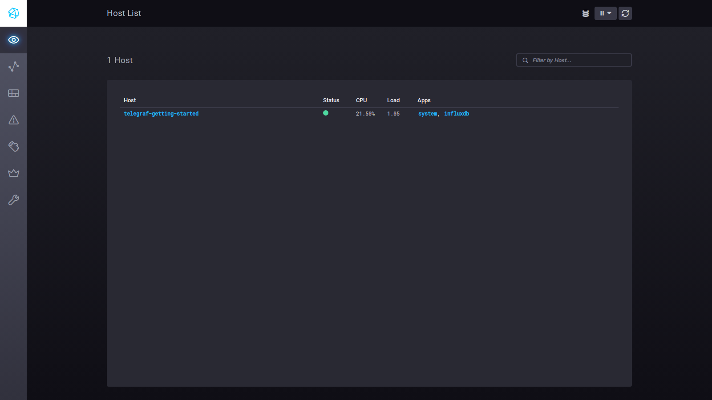
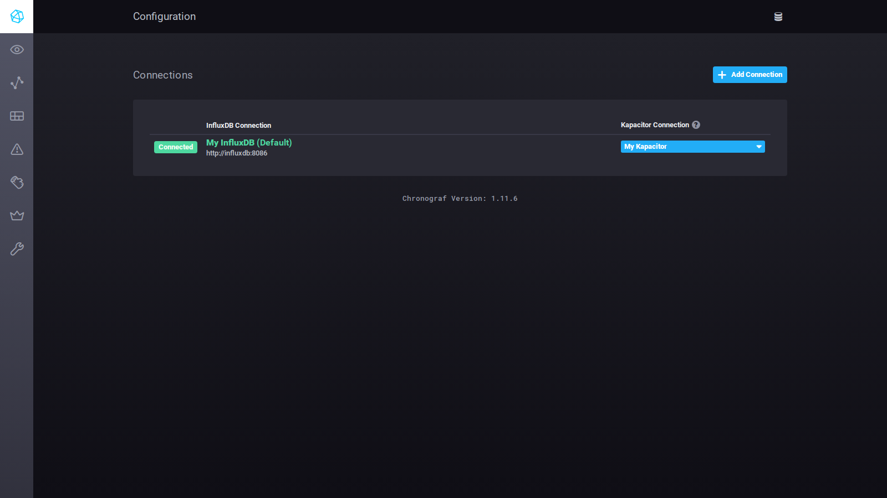
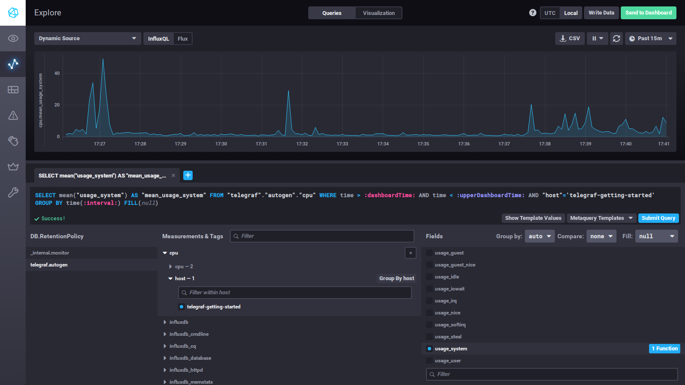
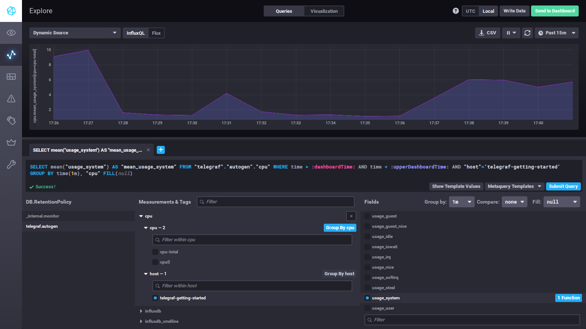
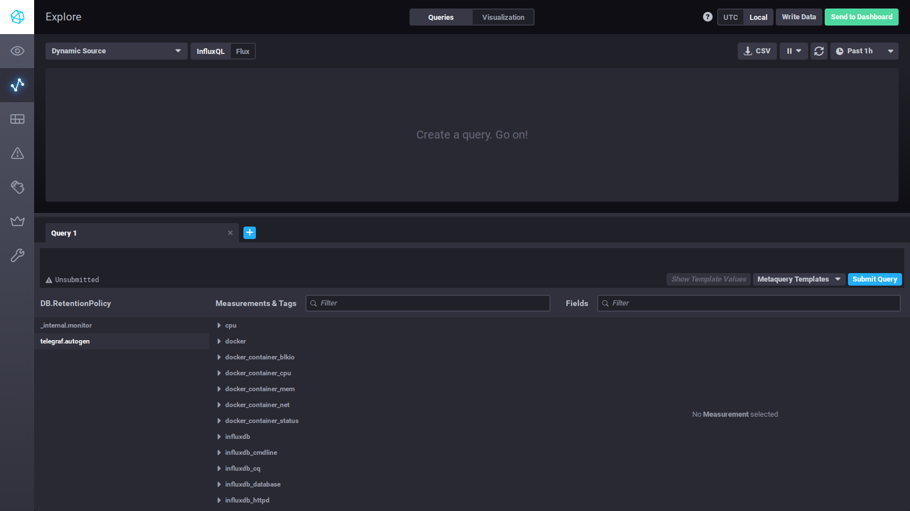
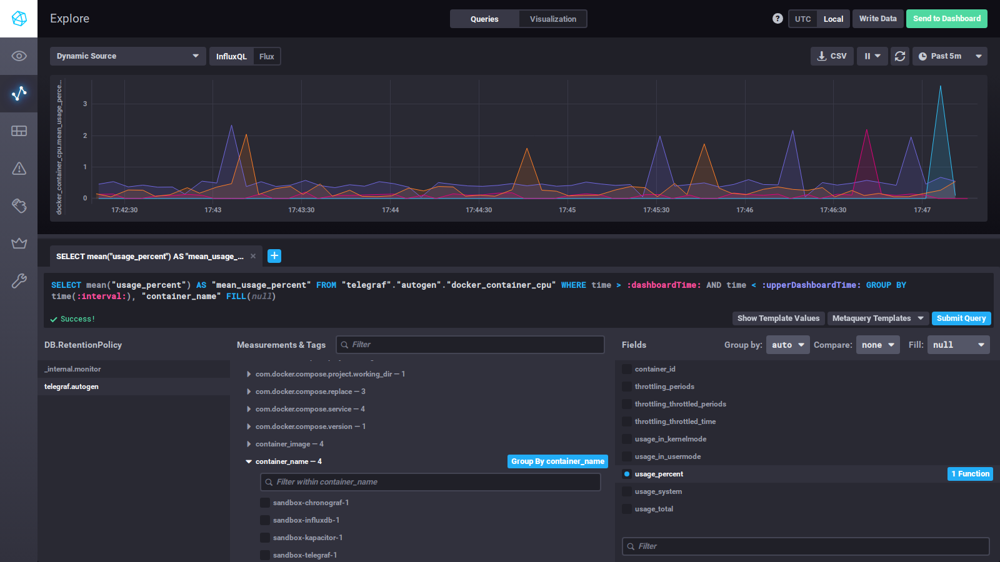

# Домашнее задание к занятию "13.Системы мониторинга - Викторов Михаил"

## Задание 1

Вас пригласили настроить мониторинг на проект. На онбординге вам рассказали, что проект представляет из себя платформу для вычислений с выдачей текстовых отчетов, которые сохраняются на диск. 
Взаимодействие с платформой осуществляется по протоколу http. Также вам отметили, что вычисления загружают ЦПУ. Какой минимальный набор метрик вы выведите в мониторинг и почему?

## Ответ

Платформа принимает задания по HTTP, считает (нагружает CPU) и сохраняет текстовые отчёты на диск.
Минимальный набор метрик закрывает два вопроса: хватает ли машине ресурсов и как работает сам сервис для клиента (метод RED - запросы, ошибки, время ответа).

**Ресурсы машины**

| Метрика | Зачем |
|---|---|
| CPU: утилизация | вычисления грузят CPU - это первое узкое место; steal на виртуальной машине показывает, что процессор забирают соседи |
| Load average в пересчёте на число ядер | LA больше числа ядер - задачи стоят в очереди и вычисления замедляются |
| Память: доступная (available), swap, OOM kill | ушли в swap - расчёты замедляются в разы; память кончилась - ядро убьёт процесс посреди расчёта |
| Диск: свободное место и свободные inodes на разделе с отчётами | отчёты - много мелких файлов, inodes могут кончиться раньше места, и запись встанет при свободных гигабайтах |
| Диск: загрузка и время отклика | запись отчётов не должна тормозить вычисления |
| Сеть: трафик, ошибки и отброшенные пакеты, число TCP-соединений | всё общение с платформой идёт по HTTP |

**Сервис**

| Метрика | Зачем |
|---|---|
| Число запросов в секунду | нагрузка и база для планирования |
| Ответы по классам кодов (2xx, 3xx, 4xx, 5xx) | доля ошибок: 5xx - сломались мы, всплеск 4xx - сломались клиенты или API |
| Время ответа | среднее прячет медленные запросы |
| Проверка доступности снаружи | видно, что сервис лежит, даже когда он сам не может отдать метрики |
| Очередь заданий, время вычисления, число успешных и упавших вычислений, ошибки записи отчёта | CPU может быть в норме, а отчёты не появляются |


---

## Задание 2

Менеджер продукта посмотрев на ваши метрики сказал, что ему непонятно что такое RAM/inodes/CPUla. 
Также он сказал, что хочет понимать, насколько мы выполняем свои обязанности перед клиентами и какое качество обслуживания. Что вы можете ему предложить?

## Ответ

RAM, inodes и LA - метрики для инженеров, они объясняют причины. Менеджеру нужны показатели,
которые описывают сервис глазами клиента. Для этого есть SLI, SLO и SLA:

- **SLA** - обязательство перед клиентом в договоре, например «99,5% запросов в месяц обрабатываются
  успешно, иначе компенсация».
- **SLO** - внутренняя цель, строже SLA, чтобы не дойти до нарушения договора, например 99,9%.
- **SLI** - то, чем измеряем:
  - доступность - доля успешных запросов (без 5xx) от всех;
  - скорость - доля запросов, обработанных быстрее N секунд;
  - качество вычислений - доля заданий, завершившихся отчётом, и доля отчётов, готовых быстрее M минут.

Предложение менеджеру - отдельный дашборд без технических терминов.

---

## Задание 3

Вашей DevOps команде в этом году не выделили финансирование на построение системы сбора логов. Разработчики в свою очередь хотят видеть все ошибки, которые выдают их приложения. 
Какое решение вы можете предпринять в этой ситуации, чтобы разработчики получали ошибки приложения?

## Ответ

Если нет системы сбора логов, ошибки можно отправлять прямо из приложения в трекер ошибок.

- **Sentry** (бесплатный self-hosted или бесплатный тариф SaaS) или более лёгкий совместимый с ним
  **GlitchTip** (open source). В приложение добавляется SDK: он ловит исключения и отправляет их
  с трейсбеком, версией релиза, окружением и параметрами запроса.
- Если нет и сервера: обработчик логирования уровня ERROR, который отправляет ошибку в чат
  (Telegram, Mattermost) или на почту, и счётчик ошибок как метрика в уже существующем мониторинге
  с алертом на рост.

---

## Задание 4

Вы, как опытный SRE, сделали мониторинг, куда вывели отображения выполнения SLA=99% по http кодам ответов. Вычисляете этот параметр по следующей формуле: summ_2xx_requests/summ_all_requests. Данный параметр не поднимается выше 70%, но при этом в вашей системе нет кодов ответа 5xx и 4xx. Где у вас ошибка?

## Ответ

Формула считает успешными только 2xx. Но кроме 2xx, 4xx и 5xx есть ещё 1xx и 3xx. Раз 4xx и 5xx нет,
оставшиеся 30% - это в основном 3xx: редиректы 301/302 (например, http на https или / на /login)
и 304 Not Modified, когда браузер берёт ответ из кеша. Это нормальные ответы, но в числитель они
не попадают.

Правильно считать так:

- (2xx + 3xx) / все запросы;
- или через ошибки: 1 - 5xx / все запросы. 4xx - ошибки клиента.

---

## Задание 5

Опишите основные плюсы и минусы pull и push систем мониторинга.

## Ответ

**Pull** - сервер мониторинга сам опрашивает цели по расписанию (Prometheus забирает `/metrics`).

| Плюсы | Минусы |
|---|---|
| Сервер сам задаёт частоту и нагрузку, агенты не могут его завалить | Серверу нужен сетевой доступ ко всем целям: NAT, файрволы, открытые порты |
| Цель не ответила - сразу видно, что она недоступна | В динамической инфраструктуре нужен service discovery |
| Метрики легко посмотреть руками: открыть `/metrics` в браузере | |
| Легко поставить второй сервер для отказоустойчивости: он опрашивает те же цели | |
| Понятно, с кем говорим: данные берём только с известных целей | |

**Push** - агенты сами отправляют метрики на сервер (Telegraf пишет в InfluxDB).

| Плюсы | Минусы |
|---|---|
| Агенту нужен только исходящий доступ: работает из-за NAT и файрволов | Агенты могут перегрузить сервер, частоту отправки сервер не контролирует |
| Подходит для коротких задач и временных машин| Тишина от агента - непонятно, упала машина или просто нет данных |
| Можно отправлять сразу в несколько хранилищ | Настройка «куда слать» на каждом агенте |
| Можно слать по UDP с минимальными накладными расходами | Принимающий порт надо защищать, иначе кто угодно запишет поддельные данные; по UDP данные теряются |

---

## Задание 6

Какие из ниже перечисленных систем относятся к push модели, а какие к pull? А может есть гибридные?

## Ответ

| Система | Модель | Почему |
|---|---|---|
| Prometheus | pull | сервер сам опрашивает `/metrics`. Push только обходным путём: короткие задачи кладут метрики в Pushgateway, а Prometheus всё равно забирает их оттуда |
| TICK | push | Telegraf отправляет метрики в InfluxDB. Сами входные плагины Telegraf могут опрашивать цели, но в базу данные доставляются push |
| Zabbix | гибрид | пассивные проверки агента и SNMP - pull (сервер спрашивает), активные проверки агента и `zabbix_sender` (trapper) - push |
| VictoriaMetrics | гибрид | принимает push и умеет pull: vmagent опрашивает цели как Prometheus |
| Nagios | pull | активные проверки: сервер запускает плагины. Пассивные проверки - push, но основная модель - pull |

---

## Задание 7


Склонируйте себе репозиторий и запустите TICK-стэк, используя технологии docker и docker-compose.

В виде решения на это упражнение приведите скриншот веб-интерфейса ПО chronograf (http://localhost:8888).

P.S.: если при запуске некоторые контейнеры будут падать с ошибкой - проставьте им режим Z, например ./data:/var/lib:Z

## Ответ

```bash
git clone https://github.com/influxdata/sandbox.git
cd sandbox
. ./.env-latest
chown -R 999:999 kapacitor/data chronograf/data
docker compose up -d --build influxdb telegraf kapacitor chronograf
```


Chronograf видит хост `telegraf-getting-started`, от которого приходят метрики:



Подключения к InfluxDB и Kapacitor:



---

## Задание 8

Перейдите в веб-интерфейс Chronograf (http://localhost:8888) и откройте вкладку Data explorer.
        
    - Нажмите на кнопку Add a query
    - Изучите вывод интерфейса и выберите БД telegraf.autogen
    - В `measurments` выберите cpu->host->telegraf-getting-started, а в `fields` выберите usage_system. Внизу появится график утилизации cpu.
    - Вверху вы можете увидеть запрос, аналогичный SQL-синтаксису. Поэкспериментируйте с запросом, попробуйте изменить группировку и интервал наблюдений.

Для выполнения задания приведите скриншот с отображением метрик утилизации cpu из веб-интерфейса.

## Ответ



Эксперимент с запросом: в конструкторе поставил «Group by: 1m» вместо `auto` (интервал усреднения
1 минута вместо автоматического) и нажал «Group By cpu» - отдельная линия для каждого ядра и для `cpu-total`
(у машины одно ядро, поэтому линии `cpu0` и `cpu-total` почти совпадают). Запрос стал таким:



---

## Задание 9

Изучите список [telegraf inputs](https://github.com/influxdata/telegraf/tree/master/plugins/inputs). 
Добавьте в конфигурацию telegraf следующий плагин - [docker](https://github.com/influxdata/telegraf/tree/master/plugins/inputs/docker):
```
[[inputs.docker]]
  endpoint = "unix:///var/run/docker.sock"
```

Дополнительно вам может потребоваться донастройка контейнера telegraf в `docker-compose.yml` дополнительного volume и 
режима privileged:
```
  telegraf:
    image: telegraf:1.4.0
    privileged: true
    volumes:
      - ./etc/telegraf.conf:/etc/telegraf/telegraf.conf:Z
      - /var/run/docker.sock:/var/run/docker.sock:Z
    links:
      - influxdb
    ports:
      - "8092:8092/udp"
      - "8094:8094"
      - "8125:8125/udp"
```

После настройке перезапустите telegraf, обновите веб интерфейс и приведите скриншотом список `measurments` в 
веб-интерфейсе базы telegraf.autogen . Там должны появиться метрики, связанные с docker.

Факультативно можете изучить какие метрики собирает telegraf после выполнения данного задания.

## Ответ

Добавил плагин в `telegraf/telegraf.conf`:

```toml
[[inputs.docker]]
  endpoint = "unix:///var/run/docker.sock"
  container_name_include = ["sandbox-*"]
```

После перезапуска:



Сами метрики: загрузка CPU контейнерами песочницы (`docker_container_cpu`, поле `usage_percent`,
группировка по `container_name`):


